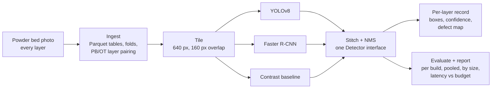
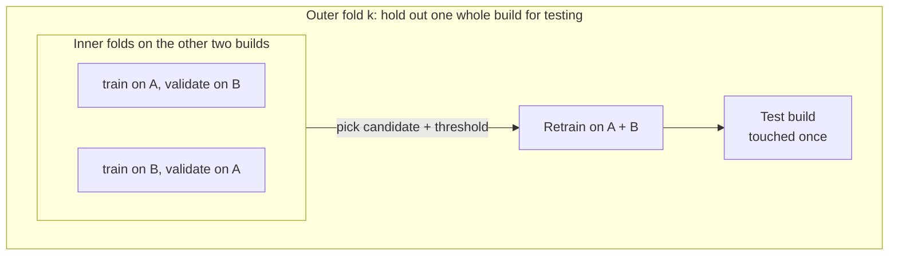
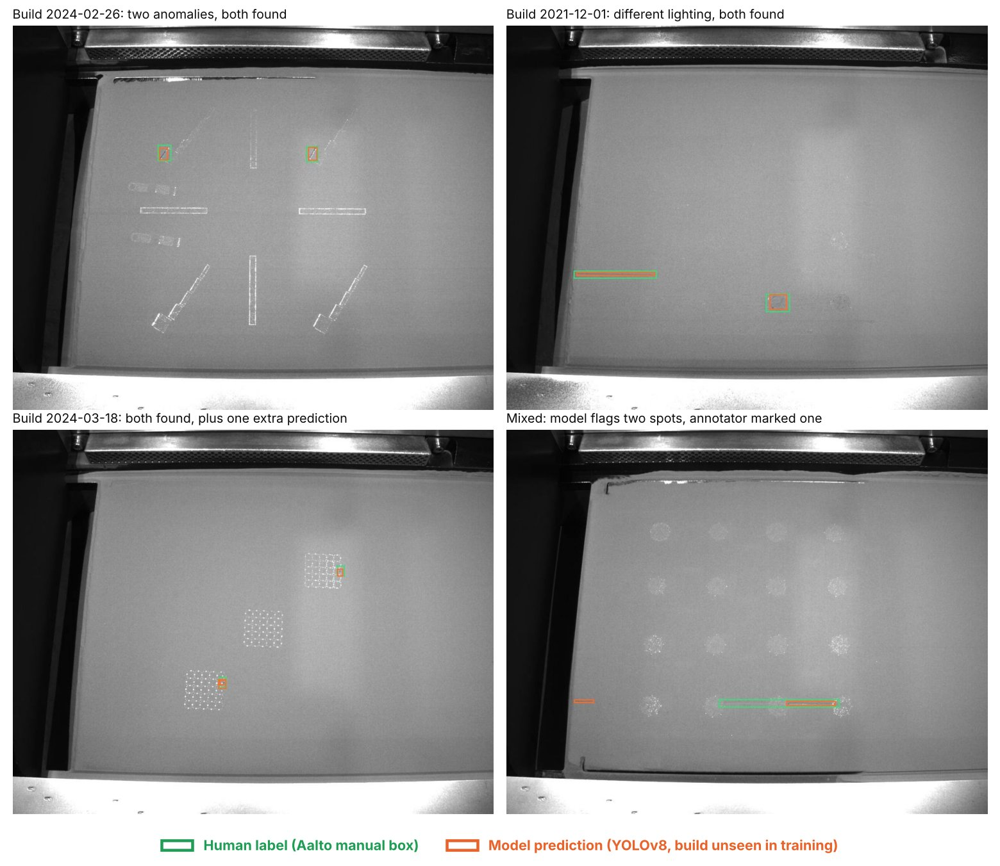

# Layerwise


**Every 20-50 seconds, a metal 3D printer spreads a fresh layer of powder and takes a photo of it.
If the recoater blade leaves a streak or a bare patch, the next layer buries it for good.
Layerwise looks at every photo and flags the bad spot in 32 ms, long before the laser fires.**

Built on 1,530 labeled powder bed images from three real laser powder bed fusion (L-PBF) builds,
and evaluated the way a production monitor would be used: on whole builds the model has never seen.

## At a glance

| | YOLOv8 (default) | Faster R-CNN | Classical baseline |
|---|---:|---:|---:|
| mAP@0.5, held-out builds | **0.270** | 0.257 | 0.001 |
| Recall @ IoU 0.5 | **0.592** | 0.521 | 0.028 |
| Precision | 0.131 | **0.212** | 0.015 |
| F1 | 0.214 | **0.301** | 0.019 |
| Latency p50 / p95, one 1280x1024 layer | **32 / 61 ms** · L4 FP16 | 137 / 147 ms · L4 FP16 | 100 / 101 ms · CPU |

- **Learned beats classical by a wide margin.** A tuned local-contrast detector (OpenCV) finds 3%
  of the anomalies; YOLOv8 finds 59%.
- **Real time with room to spare.** The budget is half of the shortest median gap between layers,
  11.0 s. YOLOv8 uses 0.3% of it.
- **Honest numbers.** Leave-one-build-out testing, size-bucketed recall, flagged weak validation
  splits, and a from-scratch rerun that reproduced the result exactly.

Every figure here comes from [`docs/results/`](docs/results/), generated by `layerwise report`.

## Why this is hard

| Challenge | What it means here | How Layerwise handles it |
|---|---|---|
| Small targets in a large frame | A streak can be a few pixels wide in a 1280x1024 image. | 640 px tiles with 160 px overlap, stitched back with NMS. |
| Every build looks different | Lighting, part layout and defect density change from job to job. | Model selection and testing on whole held-out builds. |
| The printer does not wait | A new layer arrives every 20-50 s. | A latency budget derived from the data, checked by `benchmark`. |
| Few labels | Three builds, one has only 127 labeled images. | Nested folds, a reliability flag, a non-learned baseline as the floor. |

## How it works



1. **Ingest** (`src/layerwise/ingest/`) reads the dataset in place, never copying or editing an
   image, and writes `images`, `boxes`, `layer_pairs` and `folds` as Parquet. Joins and counts are
   DuckDB SQL over Parquet. A rerun with unchanged inputs is a no-op, checked by a content manifest.
2. **Detect** (`src/layerwise/detect/`) trains three models behind one `Detector` protocol, so all
   three go through the same tiling, stitching, matching and reporting code.
3. **Predict** writes one row per processed layer plus a defect map. "No defect found" and
   "layer not processed" are never confused. The format is a
   [written contract](specs/002-powder-bed-detection/contracts/defect-representation.md) that any
   later model, such as a segmentation network, must follow.

## How it is evaluated



- **Why whole builds:** consecutive layers of one build look almost the same. A random image split
  leaks the answer into training and inflates every metric.
- **Candidates:** YOLOv8n and YOLOv8s, each at 640 and 1024 px tiles; Faster R-CNN ResNet-50 v2
  (COCO-pretrained). Choice and confidence threshold come from inner folds only.
- **Matching:** one-to-one at IoU 0.5. Recall is also split by box size (small < 32x32 px,
  large >= 96x96 px).
- **Default model:** chosen by code, not by hand: the best pooled mAP@0.5 among models that meet
  the latency budget on the target GPU.
- **Reproducibility:** YOLOv8 fold 0 was retrained from scratch with `--repro`; mAP@0.5 and recall
  matched to the last digit.

## Results

### 1. Both learned models clear the classical floor


YOLOv8 leads on mAP and recall; Faster R-CNN on precision and F1. For a monitor, a missed
anomaly can scrap a part while a false alarm costs an operator a glance, so recall and speed decide.

### 2. The build matters more than the model


| Held-out build | Images | Boxes | YOLOv8 mAP@0.5 | YOLOv8 recall | Faster R-CNN mAP@0.5 | Faster R-CNN recall |
|---|---:|---:|---:|---:|---:|---:|
| 2021-12-01 (`...1123521`) | 407 | 572 | 0.158 | 0.122 | 0.214 | 0.082 |
| 2024-02-26 (`...2095904`) | 127 | 467 | 0.446 | 0.619 | 0.298 | 0.478 |
| 2024-03-18 (`...0120348`) | 996 | 3,961 | 0.269 | 0.656 | 0.270 | 0.589 |

Recall ranges from 0.12 to 0.66 depending on which build is held out. The 2021 build has different
lighting and about 1.4 labeled boxes per image against roughly 4 in the 2024 builds. Both models
struggle on it in the same way, which points to distribution shift rather than model capacity:
more builds would move the pooled number more than a bigger network.

### 3. Small defects are the open problem


Large anomalies are found three times out of four, small ones about one time in three. That is
where the next gain lies: finer tiles, a small-object head, or the optical tomography image of the
same layer as a second input (already paired by the ingest step).

### 4. Fast enough to check every layer


The budget comes from the data: the median time between consecutive powder bed photos is 21.9 s in
the fastest build, and the monitor may use half. Measured on an AWS `g6.xlarge` (NVIDIA L4), FP16,
16 tiles per batch, 3 warm-up and 20 timed runs, JPEG decode excluded.

### 5. What the model sees



All four photos come from builds that were held out of training.

### Limits

- Labels are Aalto manual boxes for **recoating-phase anomalies** on the powder bed. Nothing here
  detects or reports porosity.
- Precision is low (YOLOv8 0.13): the detector fits operator triage, not automatic machine stops.
- Three builds is a small sample; per-build figures are indicative.
- Two inner validation splits had fewer than 150 labeled images and are flagged as unreliable in
  the report.

## Engineering

- **Config-driven.** Paths, hyperparameters and budgets live in `configs/`, with `local`, `aws` and
  `fixture` profiles.
- **Data never enters the repo.** Everything lives under `$DATA_ROOT`. A 120-image downscaled
  fixture (CC-BY, attributed) is committed so the full pipeline runs in tests.
- **Resumable.** Each fold job writes `result.json` when done and is skipped on rerun; interrupted
  training resumes from its last checkpoint.
- **Contracts and tests.** CLI behaviour, Parquet schemas and the per-layer output are written
  contracts in `specs/*/contracts/`, enforced by 200 unit, contract and integration tests
  (185 run without the `vision` extra).
- **Traceable.** MLflow tracking; every job manifest records library versions and an input hash.
- **Cloud on a budget.** Full training on one EC2 L4 instance with artifacts synced to S3 and a
  budget action that stops the instance. Runbook: [docs/aws.md](docs/aws.md).

## Quickstart

Requires Python 3.11 and [uv](https://docs.astral.sh/uv/).

```bash
uv sync --extra vision
uv run pytest      # runs on the committed fixture
make smoke         # 1-epoch end-to-end run on CPU, under a minute
```

Full data (download below, extract into `$DATA_ROOT/aalto/`):

```bash
export DATA_ROOT=/path/to/data
uv run layerwise ingest
uv run layerwise train --model yolo --profile aws
uv run layerwise train --model frcnn --profile aws
uv run layerwise baseline --profile aws
uv run layerwise report --profile aws
uv run layerwise predict --run yolo/outer_0 --profile aws
uv run layerwise benchmark --run yolo/outer_0 --profile aws
```

| Command | What it does |
|---|---|
| `ingest [--force] [--dry-run]` | Scan the dataset; write Parquet tables, manifest, ingest report. |
| `check-splits` | Fail if one build plays two roles in a fold. |
| `train --model {yolo,frcnn} [--fold N] [--repro]` | Nested leave-one-build-out training and held-out evaluation. |
| `baseline [--fold N]` | The same protocol for the classical baseline. |
| `report` | Comparison tables, latency records, default-model choice. |
| `predict --run yolo/outer_0` | Per-layer detections and defect maps. |
| `benchmark --run yolo/outer_0` | p50/p95 latency against the layer budget. |

Options and exit codes: `specs/001-peregrine-data-ingest/contracts/cli.md` and
`specs/002-powder-bed-detection/contracts/cli.md`.

## Repository layout

```
configs/          ingest and detect configs, per-profile overrides
src/layerwise/
  ingest/         dataset adapter, Parquet tables, folds, layer pairing
  detect/         tiling, staging, models, nested protocol, metrics, report
  cli.py          the `layerwise` command
specs/*/contracts CLI, table and output contracts
tests/            unit, contract, integration; fixtures/aalto (downscaled, CC-BY)
docs/             AWS runbook, figures, generated results
scripts/          smoke run, sample viewer
```

## Dataset

Aalto University L-PBF powder bed (PB) and optical tomography (OT) images with manual labels.
Zenodo, DOI [10.5281/zenodo.14996805](https://doi.org/10.5281/zenodo.14996805), CC-BY-4.0.

| Build | PB images | PB labeled | PB boxes | OT images | OT labeled | OT boxes |
|---|---:|---:|---:|---:|---:|---:|
| SI383820211201123521 | 1,000 | 407 | 572 | 1,005 | 30 | 123 |
| SI383820240226095904 | 271 | 127 | 467 | 286 | 128 | 351 |
| SI383820240318120348 | 1,367 | 996 | 3,961 | 1,383 | 966 | 3,865 |

2,636 layers have both a PB and an OT photo. Unlabeled images are never counted as defect-free.
Images in `docs/assets/` and `tests/fixtures/aalto/` are derivatives of this dataset.

## Next

Not built yet:

- Melting-phase anomalies on the OT images (class `overheated`, already ingested and paired).
- Severity score per layer and alert thresholds from the defect maps.
- ONNX / TensorRT export of the default detector.
- Part-level quality prediction from per-layer features.

## License notes

Ultralytics YOLOv8 is AGPL-3.0; its terms apply to any redistribution or hosted service built on
this code. The dataset is CC-BY-4.0.
