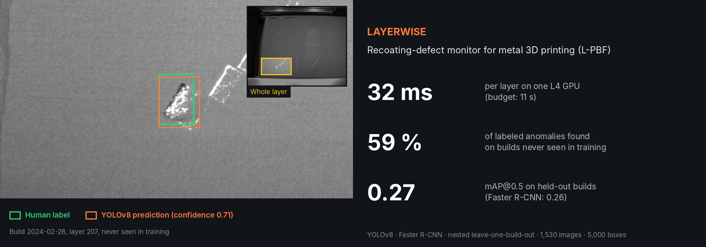
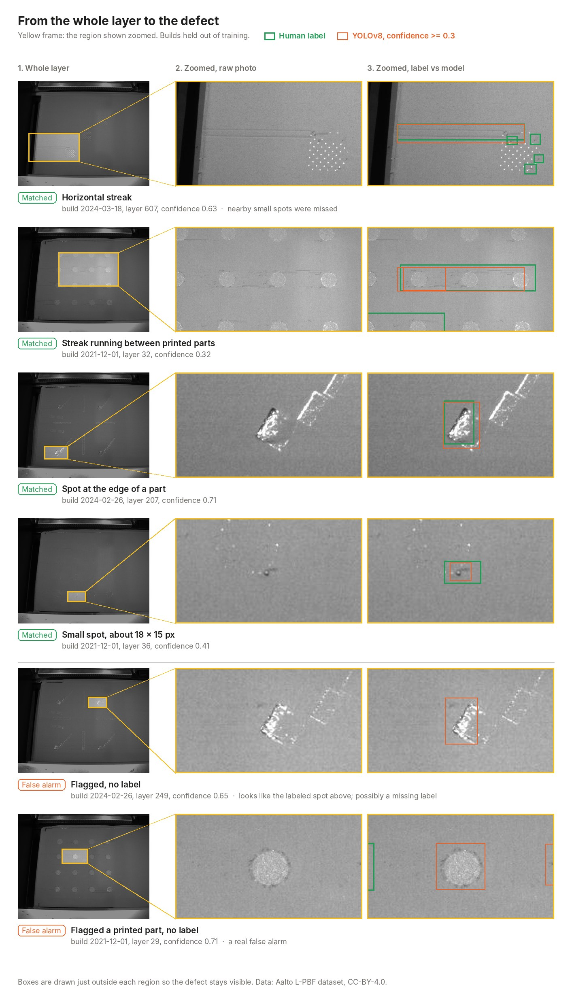
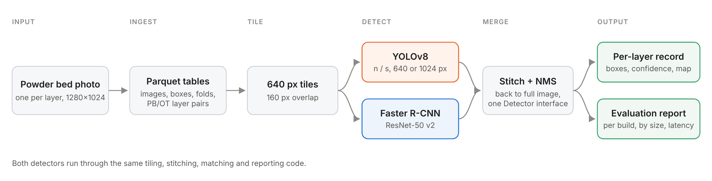
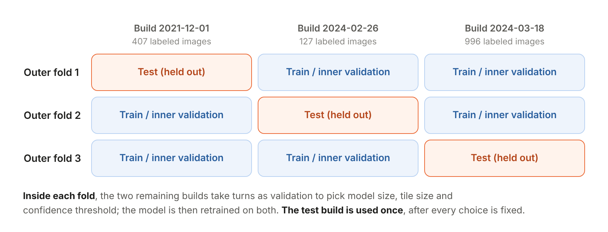
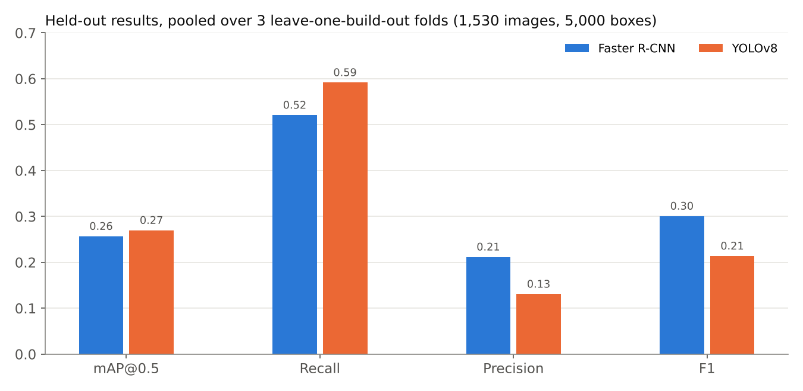
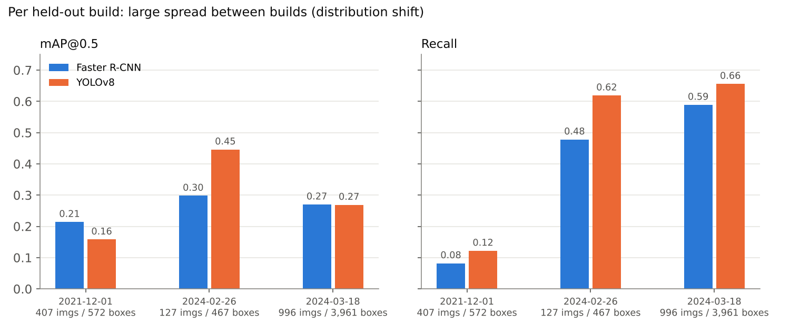
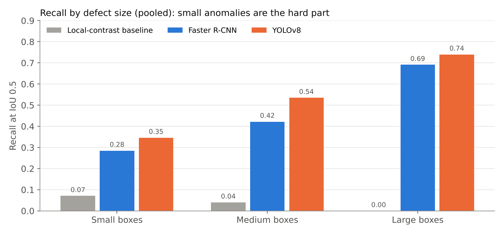
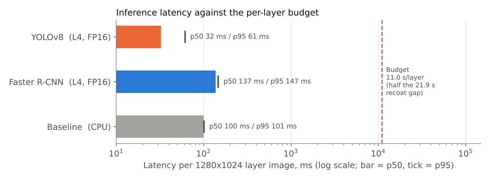

# Layerwise



A metal 3D printer (laser powder bed fusion, L-PBF) spreads a new layer of powder every 20-50
seconds and takes a photo of it. If the recoater blade leaves a streak or a bare patch, the next
layer covers it. This project is an attempt to flag those spots on each photo before the next layer
goes down.

It was built on a public dataset of 1,530 labeled powder bed images from three builds, and tested
on whole builds that the model did not see during training.

## At a glance

| Held-out builds, pooled | YOLOv8 | Faster R-CNN |
|---|---:|---:|
| mAP@0.5 | 0.270 | 0.257 |
| Recall @ IoU 0.5 | 0.592 | 0.521 |
| Precision | 0.131 | 0.212 |
| F1 | 0.214 | 0.301 |
| Latency p50 / p95 per 1280x1024 layer (NVIDIA L4, FP16) | 32 / 61 ms | 137 / 147 ms |

- On builds it has not seen, YOLOv8 finds about 6 in 10 labeled anomalies. Precision is low
  (0.13), so most of its boxes are false alarms: today it is a triage aid for an operator, not a
  signal to stop the machine.
- Inference takes a small fraction of the time between layers (32 ms against an 11 s budget), so
  speed is not the constraint; accuracy on new builds is.
- Results vary a lot from one build to another, and three builds is a small sample.

All numbers come from [`docs/results/`](docs/results/), generated by `layerwise report`.

## What it finds



Each row goes from the whole layer to a zoomed region (yellow frame), shown once as the raw photo
and once with the human label and the model's box drawn just outside the region. All layers come
from builds held out of training. The last two rows are false alarms: the first looks like a labeled
case and may be a missing label, which is one reason precision is hard to read on this data; the
second is a printed part mistaken for a defect.

## Constraints and the choices made

| Constraint | What it means here | Approach taken | Still open |
|---|---|---|---|
| Small targets | A streak can be a few pixels wide in a 1280x1024 image. | 640 px tiles with 160 px overlap, stitched back with NMS. | Small-object recall is 0.35. |
| Each build looks different | Lighting, part layout and defect density change from job to job. | Model selection and testing on whole held-out builds. | Recall on the 2021 build is 0.12. |
| Time between layers | A new layer arrives every 20-50 s. | A latency budget taken from the image timestamps, checked by `benchmark`. | Measured on a cloud GPU, not on edge hardware. |
| Few labels | Three builds; one has 127 labeled images. | Nested folds, with small validation splits flagged in the report. | More builds are needed. |

## How it works



1. **Ingest** (`src/layerwise/ingest/`) reads the dataset in place, without copying or editing any
   image, and writes `images`, `boxes`, `layer_pairs` and `folds` as Parquet. Joins and counts are
   DuckDB SQL over Parquet. A rerun with unchanged inputs does nothing, checked by a content
   manifest.
2. **Detect** (`src/layerwise/detect/`) trains both models behind one `Detector` interface, so they
   share the tiling, stitching, matching and reporting code.
3. **Predict** writes one row per processed layer plus a defect map, so "no defect found" and
   "layer not processed" stay distinct. The format is described in
   [a written contract](specs/002-powder-bed-detection/contracts/defect-representation.md).

## How it is evaluated



- **Why whole builds:** consecutive layers of one build look almost the same, so a random image
  split would put near-duplicates in training and test and overstate every metric.
- **Candidates:** YOLOv8n and YOLOv8s at 640 and 1024 px tiles; Faster R-CNN ResNet-50 v2
  (COCO-pretrained). The choice and the confidence threshold come from the inner splits only.
- **Matching:** one-to-one at IoU 0.5. Recall is also reported by box size (small < 32x32 px,
  large >= 96x96 px).
- **Default model:** picked by code, as the best pooled mAP@0.5 among models within the latency
  budget.
- **Reproducibility check:** YOLOv8 on outer fold 1 was retrained from scratch with `--repro`;
  mAP@0.5 and recall came out identical.

**A note on the classical baseline.** A local-contrast detector (OpenCV, threshold tuned on the
inner splits) was run through the same protocol as a sanity check. It scored almost zero
(pooled recall 0.028): on the 2021 build it produced 2,329 boxes and none overlapped a label at
IoU 0.5. It is left out of the charts because it is not a meaningful point of comparison; its
numbers are in [`docs/results/comparison.md`](docs/results/comparison.md).

## Results

### Pooled over the three held-out builds



The two detectors are close on mAP. YOLOv8 has higher recall, Faster R-CNN higher precision and F1.
YOLOv8 became the default because it is about 4x faster at a similar mAP. For monitoring, a missed
anomaly usually costs more than a false alarm, but the low precision is a real limitation.

### Per held-out build



| Held-out build | Images | Boxes | YOLOv8 mAP@0.5 | YOLOv8 recall | Faster R-CNN mAP@0.5 | Faster R-CNN recall |
|---|---:|---:|---:|---:|---:|---:|
| 2021-12-01 (`...1123521`) | 407 | 572 | 0.158 | 0.122 | 0.214 | 0.082 |
| 2024-02-26 (`...2095904`) | 127 | 467 | 0.446 | 0.619 | 0.298 | 0.478 |
| 2024-03-18 (`...0120348`) | 996 | 3,961 | 0.269 | 0.656 | 0.270 | 0.589 |

Recall ranges from 0.12 to 0.66 depending on which build is held out. The 2021 build has different
lighting and about 1.4 labeled boxes per image, against roughly 4 in the 2024 builds. Both models
drop on it in a similar way, which suggests a shift in the data rather than a model-specific
problem. More builds would probably help more than a larger network, but that is untested here.

### By defect size



Large anomalies are found about three times in four, small ones about one time in three. Possible
next steps: finer tiles, a small-object head, or adding the optical tomography image of the same
layer as a second input (the ingest step already pairs them).

### Latency



The budget is half of the shortest median gap between consecutive powder bed photos (21.9 s).
Measured on an AWS `g6.xlarge` (NVIDIA L4), FP16, 16 tiles per batch, 3 warm-up and 20 timed runs,
JPEG decode excluded. No edge device has been tested.

### Limits

- Labels are Aalto manual boxes for **recoating-phase anomalies** on the powder bed. Nothing here
  detects or reports porosity.
- Precision is low (YOLOv8 0.13).
- Three builds is a small sample; per-build figures are indicative only.
- Two inner validation splits had fewer than 150 labeled images and are flagged in the report.

## Notes on the code

- Paths, hyperparameters and budgets live in `configs/`, with `local`, `aws` and `fixture` profiles.
- Data stays outside the repo under `$DATA_ROOT`. A 120-image downscaled fixture (CC-BY, with
  attribution) is committed so the pipeline can run in tests.
- Each fold job writes `result.json` when it finishes and is skipped on rerun; interrupted training
  resumes from its last checkpoint.
- CLI behaviour, Parquet schemas and the per-layer output are written down in `specs/*/contracts/`
  and checked by 200 unit, contract and integration tests (185 run without the `vision` extra).
- Runs are tracked in a local MLflow store; job manifests record library versions and an input hash.
- Full training ran on one EC2 L4 instance with artifacts in S3: [docs/aws.md](docs/aws.md).

## Quickstart

Requires Python 3.11 and [uv](https://docs.astral.sh/uv/).

```bash
uv sync --extra vision
uv run pytest      # runs on the committed fixture
make smoke         # 1-epoch end-to-end run on CPU, under a minute
```

Full data (download below, extract into `$DATA_ROOT/aalto/`):

```bash
export DATA_ROOT=/path/to/data
uv run layerwise ingest
uv run layerwise train --model yolo --profile aws
uv run layerwise train --model frcnn --profile aws
uv run layerwise baseline --profile aws
uv run layerwise report --profile aws
uv run layerwise predict --run yolo/outer_0 --profile aws
uv run layerwise benchmark --run yolo/outer_0 --profile aws
```

| Command | What it does |
|---|---|
| `ingest [--force] [--dry-run]` | Scan the dataset; write Parquet tables, manifest, ingest report. |
| `check-splits` | Fail if one build plays two roles in a fold. |
| `train --model {yolo,frcnn} [--fold N] [--repro]` | Nested leave-one-build-out training and held-out evaluation. |
| `baseline [--fold N]` | The same protocol for the classical baseline. |
| `report` | Comparison tables, latency records, default-model choice. |
| `predict --run yolo/outer_0` | Per-layer detections and defect maps. |
| `benchmark --run yolo/outer_0` | p50/p95 latency against the layer budget. |

Options and exit codes: `specs/001-peregrine-data-ingest/contracts/cli.md` and
`specs/002-powder-bed-detection/contracts/cli.md`.

## Repository layout

```
configs/          ingest and detect configs, per-profile overrides
src/layerwise/
  ingest/         dataset adapter, Parquet tables, folds, layer pairing
  detect/         tiling, staging, models, nested protocol, metrics, report
  cli.py          the `layerwise` command
specs/*/contracts CLI, table and output contracts
tests/            unit, contract, integration; fixtures/aalto (downscaled, CC-BY)
docs/             AWS runbook, figures, generated results
scripts/          smoke run, sample viewer
```

## Dataset

Aalto University L-PBF powder bed (PB) and optical tomography (OT) images with manual labels.
Zenodo, DOI [10.5281/zenodo.14996805](https://doi.org/10.5281/zenodo.14996805), CC-BY-4.0.
Thanks to the authors for making it public.

| Build | PB images | PB labeled | PB boxes | OT images | OT labeled | OT boxes |
|---|---:|---:|---:|---:|---:|---:|
| SI383820211201123521 | 1,000 | 407 | 572 | 1,005 | 30 | 123 |
| SI383820240226095904 | 271 | 127 | 467 | 286 | 128 | 351 |
| SI383820240318120348 | 1,367 | 996 | 3,961 | 1,383 | 966 | 3,865 |

2,636 layers have both a PB and an OT photo. Unlabeled images are never counted as defect-free.
Images in `docs/assets/` and `tests/fixtures/aalto/` are derivatives of this dataset.

## Next

Not built yet:

- Melting-phase anomalies on the OT images (class `overheated`, already ingested and paired).
- A severity score per layer and alert thresholds from the defect maps.
- ONNX / TensorRT export and a test on edge hardware.
- Part-level quality prediction from per-layer features.

## License notes

Ultralytics YOLOv8 is AGPL-3.0; its terms apply to any redistribution or hosted service built on
this code. The dataset is CC-BY-4.0.
